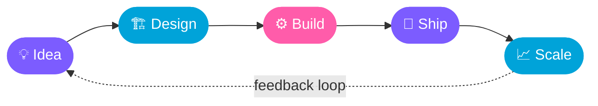
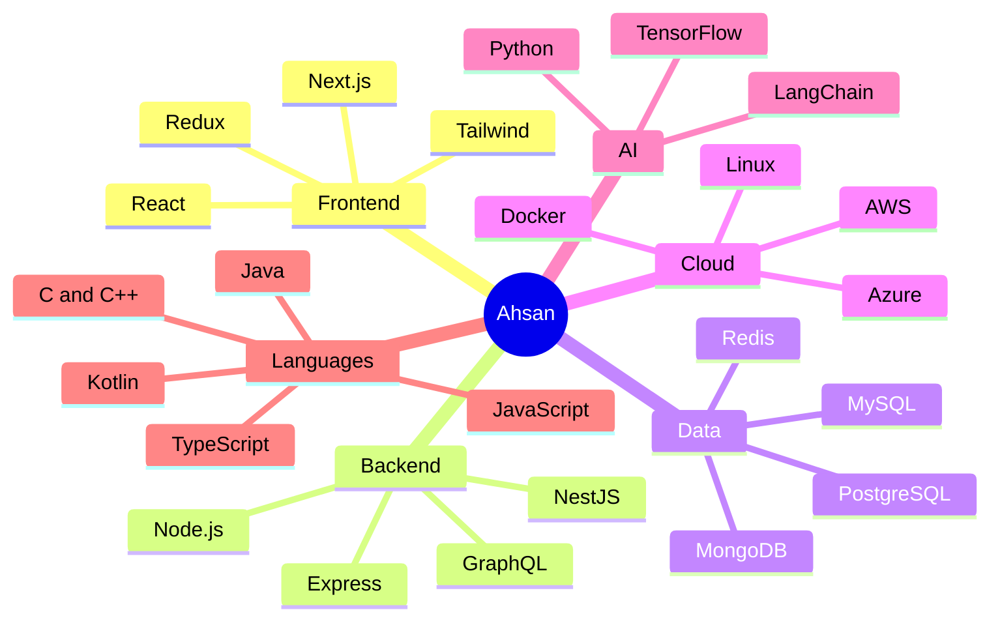

<!-- ═══════════════════════ HEADER ═══════════════════════ -->
<div align="center">


<a href="https://github.com/ahsanfarooq210">
  
</a>

<br/><br/>


<a href="https://github.com/ahsanfarooq210?tab=followers"></a>
<a href="https://github.com/ahsanfarooq210?tab=repositories"></a>


</div>


<!-- ═══════════════════════ ABOUT ═══════════════════════ -->
<div align="center">

</div>

<table>
<tr>
<td width="58%" valign="top">

```ts
const ahsan = {
  role: "Senior Software Engineer",
  type: "Full Stack Developer",
  focus: [
    "Web Platforms",
    "AI Agents",
    "Distributed Systems",
  ],
  currentlyLearning: [
    "LangChain",
    "System Design",
  ],
  stack: [
    "TypeScript", "React", "Next.js",
    "NestJS", "Python", "AWS",
  ],
  reachMe: "ahsanfarooq210@gmail.com",
} as const;
```

</td>
<td width="42%" valign="top">

### 🔭 Right now
- 🌱 Learning **LangChain** & **system design**
- 🤖 Exploring **AI agent** workflows
- 🏗️ Turning messy requirements into clean, scalable architecture

### 📫 Reach me
**ahsanfarooq210@gmail.com**

</td>
</tr>
</table>


<!-- ═══════════════════════ WHAT I DO ═══════════════════════ -->
<div align="center">

</div>

<table align="center">
<tr>
<td align="center" width="33%">
<h3>🖥️ Full Stack</h3>
<sub>React, Next.js, Node.js, NestJS<br/>Clean APIs and polished UIs</sub>
</td>
<td align="center" width="33%">
<h3>🏗️ System Design</h3>
<sub>Scalable, resilient architecture<br/>Built to grow with the product</sub>
</td>
<td align="center" width="33%">
<h3>🤖 AI Engineering</h3>
<sub>LangChain, Python, agents<br/>LLM-powered products</sub>
</td>
</tr>
</table>


<!-- ═══════════════════════ HOW I BUILD ═══════════════════════ -->
<div align="center">

</div>




<!-- ═══════════════════════ TECH STACK ═══════════════════════ -->
<div align="center">

</div>

<div align="center">

<table>
<tr><td align="right"><b>Languages</b></td>
<td></td></tr>
<tr><td align="right"><b>Frontend</b></td>
<td></td></tr>
<tr><td align="right"><b>Backend</b></td>
<td></td></tr>
<tr><td align="right"><b>Databases</b></td>
<td></td></tr>
<tr><td align="right"><b>Cloud &amp; DevOps</b></td>
<td></td></tr>
<tr><td align="right"><b>Mobile &amp; Tools</b></td>
<td></td></tr>
<tr><td align="right"><b>AI / ML</b></td>
<td>&nbsp;</td></tr>
</table>

</div>

### 🧠 Skills Map




<!-- ═══════════════════════ STATS ═══════════════════════ -->
<div align="center">

</div>

<div align="center">

<a href="https://github.com/ahsanfarooq210">
<picture>
  <source media="(prefers-color-scheme: dark)" srcset="https://github-readme-stats.vercel.app/api?username=ahsanfarooq210&show_icons=true&theme=tokyonight&hide_border=true&bg_color=0D1117&title_color=7C5CFF&icon_color=00D1FF&text_color=C9D1D9&count_private=true&border_radius=12" />
  <source media="(prefers-color-scheme: light)" srcset="https://github-readme-stats.vercel.app/api?username=ahsanfarooq210&show_icons=true&theme=default&hide_border=true&title_color=7C5CFF&icon_color=00A3D9&border_radius=12&count_private=true" />
  
</picture>
</a>
<a href="https://github.com/ahsanfarooq210">
<picture>
  <source media="(prefers-color-scheme: dark)" srcset="https://github-readme-stats.vercel.app/api/top-langs/?username=ahsanfarooq210&layout=compact&theme=tokyonight&hide_border=true&bg_color=0D1117&title_color=7C5CFF&text_color=C9D1D9&border_radius=12" />
  <source media="(prefers-color-scheme: light)" srcset="https://github-readme-stats.vercel.app/api/top-langs/?username=ahsanfarooq210&layout=compact&theme=default&hide_border=true&title_color=7C5CFF&border_radius=12" />
  
</picture>
</a>

<br/>

<picture>
  <source media="(prefers-color-scheme: dark)" srcset="https://streak-stats.demolab.com/?user=ahsanfarooq210&theme=tokyonight&hide_border=true&background=0D1117&ring=7C5CFF&fire=FF6B35&currStreakLabel=7C5CFF&border_radius=12" />
  <source media="(prefers-color-scheme: light)" srcset="https://streak-stats.demolab.com/?user=ahsanfarooq210&theme=default&hide_border=true&ring=7C5CFF&fire=FF6B35&currStreakLabel=7C5CFF&border_radius=12" />
  
</picture>

<br/><br/>

<a href="https://github.com/ahsanfarooq210">
  
</a>

</div>


<!-- ═══════════════════════ BLOG ═══════════════════════ -->
<div align="center">

</div>

<!-- BLOG-POST-LIST:START -->
<!-- BLOG-POST-LIST:END -->


<!-- ═══════════════════════ SOCIALS ═══════════════════════ -->
<div align="center">

</div>

<div align="center">

<a href="https://www.linkedin.com/in/ahsan-farooq-9b36a811b/"></a>
<a href="https://dev.to/ahsanfarooq210"></a>
<a href="https://www.leetcode.com/ahsanfarooq210"></a>
<a href="https://www.hackerrank.com/ahsanfarooq210"></a>
<a href="https://www.hackerearth.com/@ahsanfarooq210"></a>
<a href="https://codesandbox.com/ahsanfarooq210"></a>
<a href="mailto:ahsanfarooq210@gmail.com"></a>

<br/><br/>


<br/><br/>

<a href="https://github.com/ahsanfarooq210">
  
</a>

</div>


